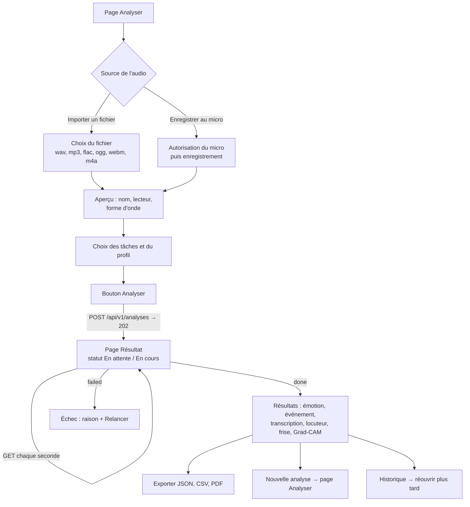

# Parcours utilisateur et maquettes — pages Analyser et Résultat

Brique 7 (interface). Ce document est à valider en équipe **avant** de coder la page Résultat
et les messages d'erreur.

Exigences couvertes : EF-01 à EF-07, EF-09 à EF-13, ENF-03, ENF-06, ENF-12.
Décisions : U5 (wavesurfer.js, Recharts), U6 (spectrogramme calculé par le serveur), U7 (erreurs
soignées, interface en français).

> **État au 10 novembre 2026.**
> - La page **Analyser** est codée dans la PR #7 (`feat/page-analyser-nicole`) : import, micro,
>   forme d'onde, tâches, profil, envoi et suivi du statut.
> - La page **Résultat** n'existe pas.
> - L'API ne renvoie encore **aucun résultat de modèle**, car aucun modèle n'est branché
>   (`configs/registry.yaml` est vide).
> - Les champs de résultat décrits ici sont donc des **propositions**, à fixer avec Luciano dans
>   le contrat de `GET /api/v1/analyses/{id}`.

## 1. Parcours utilisateur

### Parcours principal



### Étape par étape

| # | L'utilisateur… | L'application… |
| --- | --- | --- |
| 1 | ouvre la page Analyser | affiche les deux boutons de source ; le bouton Analyser est grisé, avec la consigne « Importez un fichier ou enregistrez-vous au micro pour commencer. » |
| 2a | importe un fichier | affiche le nom, le lecteur et la forme d'onde |
| 2b | clique sur « Enregistrer au micro » | demande l'autorisation, affiche « ● Enregistrement en cours… » ; à l'arrêt, coupe le micro et affiche l'aperçu |
| 3 | coche les tâches, choisit le profil | garde par défaut Émotion et Événement sonore, profil Qualité ; si aucune tâche n'est cochée, grise le bouton et l'explique |
| 4 | clique sur Analyser | envoie le fichier, affiche « Envoi du fichier au serveur… » ; en cas de refus (format, durée, silence…), affiche le message du serveur **sur la page Analyser**, sans perdre l'audio ni les choix |
| 5 | — | **proposition** : à la réponse 202, ouvre la page Résultat `/analyses/{id}`, qui suit le statut |
| 6 | attend | affiche le statut (« En attente », « En cours ») et des emplacements vides à la place des résultats ; l'interface reste utilisable (ENF-03) |
| 7 | lit les résultats | affiche chaque tâche demandée ; les tâches non demandées n'apparaissent pas |
| 8 | explore | lit l'audio, clique sur un segment de la frise ou de la transcription pour y sauter, active la carte Grad-CAM |
| 9 | exporte ou recommence | télécharge JSON, CSV ou PDF ; ou revient à Analyser |

### Parcours alternatifs

| Situation | Ce qui se passe |
| --- | --- |
| Fichier refusé au POST (400 ou 413) | On reste sur Analyser, le message du serveur s'affiche sous le bouton, l'audio reste chargé |
| Échec pendant le traitement (`failed`) | La page Résultat affiche la raison et un bouton « Relancer l'analyse », qui ramène sur Analyser |
| Serveur arrêté pendant le suivi | Message « Connexion au serveur perdue… », nouvelle tentative automatique |
| L'utilisateur quitte la page Résultat pendant le traitement | Le traitement continue côté serveur ; l'analyse se retrouve dans l'Historique |
| Lien vers une analyse supprimée ou inconnue | Page Résultat en état « introuvable », avec un lien vers l'Historique |

## 2. Maquette — page Analyser

La maquette reprend ce qui est codé dans la PR #7. Les différences proposées sont marquées ★.

```
┌──────────────────────────────────────────────────────────────────────────┐
│ EchoLens   [Analyser] Direct  Comparer  Historique  Locuteurs  Modèles   │
├──────────────────────────────────────────────────────────────────────────┤
│                                                                          │
│  Analyser un audio                                                       │
│  Importez un fichier ou enregistrez-vous au micro, choisissez les        │
│  tâches, puis lancez l'analyse.                                          │
│                                                                          │
│  ┌───────────────────────┐  ┌───────────────────────┐                    │
│  │  Importer un fichier  │  │  Enregistrer au micro │                    │
│  └───────────────────────┘  └───────────────────────┘                    │
│  ★ Formats : wav, mp3, flac, ogg, webm, m4a · 5 min et 100 Mo maximum    │
│                                                                          │
│  Fichier : entretien.wav                                                 │
│  ▶ ━━━━━━━━━━━━━━━●──────────────────────────────  0:12 / 0:41          │
│                                                                          │
│  Forme d'onde                                                            │
│  ┌────────────────────────────────────────────────────────────────────┐  │
│  │ ▁▂▅▇█▇▅▃▁▁▂▃▆█▇▆▃▂▁▁▁▂▄▆▇█▇▅▂▁▁▂▃▅▇▆▄▂▁▁▂▄▅▇█▆▄▂▁                │  │
│  └────────────────────────────────────────────────────────────────────┘  │
│  Spectrogramme                                                           │
│  ┌ ─ ─ ─ ─ ─ ─ ─ ─ ─ ─ ─ ─ ─ ─ ─ ─ ─ ─ ─ ─ ─ ─ ─ ─ ─ ─ ─ ─ ─ ─ ─ ─ ─ ┐  │
│     Spectrogramme calculé par le serveur — bientôt disponible            │
│  └ ─ ─ ─ ─ ─ ─ ─ ─ ─ ─ ─ ─ ─ ─ ─ ─ ─ ─ ─ ─ ─ ─ ─ ─ ─ ─ ─ ─ ─ ─ ─ ─ ─ ┘  │
│                                                                          │
│  Que souhaitez-vous analyser ?                                           │
│  [x] Émotion   [x] Événement sonore   [ ] Transcription   [ ] Locuteur   │
│  Profil : [ Qualité ▾ ]                                                  │
│                                                                          │
│  ┌────────────┐                                                          │
│  │  Analyser  │   (grisé tant qu'il manque l'audio ou une tâche)         │
│  └────────────┘                                                          │
│  ⚠ Message d'erreur du serveur, ici, en rouge, si l'envoi est refusé.   │
│                                                                          │
├──────────────────────────────────────────────────────────────────────────┤
│                     API connectée · version 0.1.0                        │
└──────────────────────────────────────────────────────────────────────────┘
```

Propositions ★ à valider :

1. **Afficher les limites** (formats, 5 min, 100 Mo) sous les boutons, pour éviter un refus prévisible.
2. **Aller sur la page Résultat après le 202**, au lieu d'afficher le suivi sur Analyser. Le même
   écran sert alors pour une analyse en cours et pour une analyse réouverte depuis l'Historique
   (EF-08). Conséquence : `AnalysisStatus` passe de la page Analyser à la page Résultat.
3. Sur téléphone (ENF-12), les deux boutons de source s'empilent et les cases à cocher passent sur
   une colonne.

## 3. Maquette — page Résultat (`/analyses/{id}`, proposition)

### État « terminé »

```
┌──────────────────────────────────────────────────────────────────────────┐
│ EchoLens   Analyser  Direct  Comparer  [Historique]  Locuteurs  Modèles  │
├──────────────────────────────────────────────────────────────────────────┤
│  ← Nouvelle analyse                                                      │
│                                                                          │
│  entretien.wav                         Exporter : [JSON] [CSV] [PDF]     │
│  10 nov. 2026, 14:32 · 41,2 s · profil Qualité · ● Terminée              │
│                                                                          │
│  ┌─ Audio ─────────────────────────────────────────────────────────────┐ │
│  │ ▶ ━━━━━━━━━━━━●──────────────────────────────  0:12 / 0:41  (EF-03) │ │
│  │ ▁▂▅▇█▇▅▃▁▁▂▃▆█▇▆▃▂▁│▁▁▂▄▆▇█▇▅▂▁▁▂▃▅▇▆▄▂▁▁▂▄▅▇█▆▄▂▁   ← curseur      │ │
│  │ Spectrogramme Mel (EF-04)                [ ] Carte Grad-CAM (EF-13)  │ │
│  │ 8 kHz ░░▒▒▓▓██▓▒░░░▒▓██▓▒░│░░▒▓▓█▓▒░░░▒▒▓██▓▒░                       │ │
│  │   0   ░▒▓██▓▒▒▓▓██▓▒░▒▓██▓│▓▒▓██▓▓▒░▒▓▓██▓▓▒░                       │ │
│  └─────────────────────────────────────────────────────────────────────┘ │
│                                                                          │
│  ┌─ Frise temporelle (EF-12) ──────────────────────────────────────────┐ │
│  │ Émotion    │ Neutre      │ Colère          │ Neutre               │ │
│  │ Événement  │ Parole                         │ Porte │ Parole       │ │
│  │ Locuteur   │ Nicole                │ Inconnu                       │ │
│  │ Texte      │ « Bonjour… »│ « Je ne suis pas d'accord… »│ …          │ │
│  │            0 s          10 s         20 s         30 s        41 s │ │
│  └─────────────────────────────────────────────────────────────────────┘ │
│                                                                          │
│  ┌─ Émotion (EF-05) ────────────┐  ┌─ Événement sonore (EF-06) ───────┐  │
│  │ Colère     ████████████ 58 % │  │ Parole        ███████████ 71 %   │  │
│  │ Neutre     █████        24 % │  │ Porte         ███         12 %   │  │
│  │ Tristesse  ██            9 % │  │ Pas           ██           7 %   │  │
│  │ Peur       █             5 % │  │ Clavier       █            4 %   │  │
│  │ Joie       ▏             3 % │  │ Pluie         ▏            2 %   │  │
│  │ Dégoût     ▏             1 % │  │ … 5 premières sur 50 classes     │  │
│  │ Modèle : emotion-cnn 0.1.0   │  │ Modèle : … · probabilités        │  │
│  │ · probabilités calibrées     │  │ calibrées (ENF-06)               │  │
│  └──────────────────────────────┘  └──────────────────────────────────┘  │
│                                                                          │
│  ┌─ Transcription (EF-10) ──────┐  ┌─ Locuteur (EF-11) ───────────────┐  │
│  │ 0:00 – 0:08  Bonjour, je…    │  │ Nicole         similarité 0,82   │  │
│  │ 0:08 – 0:21  Je ne suis pas… │  │ Inconnu        (sous le seuil)   │  │
│  │ (clic sur une ligne → lecture│  │                                  │  │
│  │  à partir de ce moment)      │  │                                  │  │
│  └──────────────────────────────┘  └──────────────────────────────────┘  │
└──────────────────────────────────────────────────────────────────────────┘
```

Règles d'affichage :

| Élément | Règle |
| --- | --- |
| Cartes de tâche | Seules les tâches demandées apparaissent |
| Probabilités | Toutes les classes pour l'émotion (6) ; les 5 premières pour l'événement (50), avec un lien « Voir tout » ; libellés français de `configs/labels.yaml` ; barres Recharts (U5) |
| Modèle utilisé | Identifiant et version du registre sous chaque résultat, pour la traçabilité et la comparaison |
| Curseur | Le curseur de lecture se déplace sur la forme d'onde, le spectrogramme et la frise en même temps (EF-03, wavesurfer.js) |
| Clic sur la frise ou la transcription | La lecture saute au début du segment |
| Case Grad-CAM | Désactivée par défaut. Grisée avec une explication si le modèle d'émotion n'est pas de la famille A (E7 : pas de Grad-CAM pour les encodeurs pré-entraînés) |
| Locuteur inconnu | « Inconnu » est un **résultat**, pas une erreur : il s'affiche en gris, sans rouge |
| Exports | Désactivés tant que l'analyse n'est pas terminée |

### Autres états de la page Résultat

```
En cours                                     Échec
┌──────────────────────────────────────┐     ┌──────────────────────────────────────┐
│ entretien.wav                        │     │ entretien.wav                        │
│ ◌ En cours… (actualisation chaque s) │     │ ✕ Échec                              │
│                                      │     │                                      │
│ ┌ Audio ───────────────────────────┐ │     │ L'analyse n'a pas pu aboutir :       │
│ │ ░░░░░░░ emplacement gris ░░░░░░░ │ │     │ « <raison donnée par le serveur> »   │
│ └──────────────────────────────────┘ │     │                                      │
│ ┌ Émotion ┐ ┌ Événement ┐            │     │ [ Relancer l'analyse ]               │
│ │ ░░░░░░░ │ │ ░░░░░░░░░ │            │     │ [ Voir l'historique ]                │
│ └─────────┘ └───────────┘            │     │                                      │
│ Vous pouvez quitter cette page :     │     └──────────────────────────────────────┘
│ l'analyse continue et restera dans   │
│ l'historique.                        │     Introuvable
└──────────────────────────────────────┘     ┌──────────────────────────────────────┐
                                             │ Cette analyse n'existe pas ou a été  │
Modèles pas encore branchés                  │ supprimée.                           │
┌──────────────────────────────────────┐     │ [ Voir l'historique ]                │
│ ● Terminée · 41,2 s                  │     └──────────────────────────────────────┘
│ Résultats disponibles quand les      │
│ modèles seront branchés.             │
└──────────────────────────────────────┘
```

### Données nécessaires (à ajouter au contrat de l'API)

À définir avec Luciano avant de coder. Aucun de ces champs n'existe aujourd'hui dans
`AnalysisSchema`.

| Besoin de la page | Champ proposé |
| --- | --- |
| Spectrogramme (U6) | URL d'une image ou d'une matrice log-Mel calculée par `core.features` |
| Carte Grad-CAM | URL ou matrice de même taille que le spectrogramme, avec la classe expliquée |
| Émotion, événement | Liste `{label, probability}` par segment, plus le résultat global, avec l'identifiant et la version du modèle |
| Transcription | Segments `{start_s, end_s, text}` |
| Locuteur | `{speaker_id ou null, similarity}` par segment |
| Frise | Les segments ci-dessus, avec leurs bornes en secondes |

## 4. Catalogue des messages d'erreur

Règles d'écriture (ENF-12, U7) :

- dire **ce qui s'est passé**, puis **ce que l'utilisateur peut faire** ;
- vouvoiement, phrases courtes, accents, ni code HTTP ni jargon technique dans le texte ;
- ne jamais accuser l'utilisateur d'une panne du serveur ;
- garder ce que l'utilisateur a déjà fait (audio, choix) après une erreur.

Colonne « État » : **existant** (déjà dans le code), **à corriger**, **à coder**.

### 4.1 Erreurs renvoyées par le serveur (champ `message`)

| # | Situation | Message | Où | État |
| --- | --- | --- | --- | --- |
| S1 | Extension refusée | Format non pris en charge : « {nom} ». Formats acceptés : wav, mp3, flac, ogg, webm, m4a. | `services/analysis_service.py` | existant |
| S2 | Fichier corrompu | Fichier audio illisible ou corrompu : impossible de le décoder. | idem | existant |
| S3 | Audio de plus de 5 min | Audio trop long : {durée} s (maximum autorisé : 300 s) | `core/audio/io.py` | **à corriger** : donner la limite en minutes (« 5 min maximum ») et ajouter le point final |
| S4 | Audio silencieux | L'audio est silencieux : aucun son exploitable détecté. | `services/analysis_service.py` | existant |
| S5 | Fichier de plus de 100 Mo | Fichier trop volumineux : 100 Mo maximum. | `api/errors.py` | existant |
| S6 | Aucune tâche | Choisissez au moins une tâche (champ tasks). | `api/analyses.py` | **à corriger** : retirer « (champ tasks) », jargon technique. En pratique, le front l'empêche déjà |
| S7 | Aucun fichier | Aucun fichier reçu (champ file). | idem | **à corriger** : retirer « (champ file) » |
| S8 | Analyse inconnue | Analyse introuvable : {identifiant} | `services/analysis_service.py` | existant ; la page Résultat affiche son propre texte (F12) |
| S9 | Redémarrage du serveur pendant le traitement | Traitement interrompu par un redémarrage du serveur : relancez l'analyse. | idem | existant |
| S10 | **ffmpeg absent du serveur** | Aujourd'hui : « Fichier audio illisible ou corrompu… » (S2) | idem | **à corriger** : le fichier n'y est pour rien. Proposition : erreur 500 « Le serveur ne peut pas décoder l'audio pour l'instant : réessayez plus tard ou prévenez l'équipe. » |
| S11 | Erreur inattendue pendant le traitement | Aujourd'hui : « Échec du traitement : {texte de l'exception Python} » | idem | **à corriger** : le texte brut de l'exception peut être en anglais et technique. Proposition : « L'analyse a échoué à cause d'une erreur du serveur. Relancez-la ; si le problème continue, prévenez l'équipe. » ; détail dans les journaux du serveur |
| S12 | Erreur interne | Erreur interne du serveur : réessayez plus tard. | `api/errors.py` | existant |
| S13 | Modèle demandé indisponible | « Le modèle {tâche} n'est pas encore disponible : décochez cette tâche ou réessayez plus tard. » | — | **à coder** quand les modèles seront branchés |

### 4.2 Erreurs détectées par le navigateur

| # | Situation | Message | État |
| --- | --- | --- | --- |
| F1 | Serveur injoignable à l'envoi | Serveur injoignable : lancez le serveur Flask (make run). | existant ; **à corriger** pour la démo : « Le serveur ne répond pas. Vérifiez qu'il est lancé, puis réessayez. » (« make run » ne parle qu'aux développeurs) |
| F2 | Micro refusé par l'utilisateur (`NotAllowedError`) | Accès au micro refusé : autorisez-le dans votre navigateur. | existant |
| F3 | Aucun micro branché (`NotFoundError`) | « Aucun micro détecté : branchez-en un, ou importez un fichier. » | **à coder** : aujourd'hui confondu avec F2 |
| F4 | Micro déjà utilisé par une autre application (`NotReadableError`) | « Le micro est déjà utilisé par une autre application : fermez-la, puis réessayez. » | **à coder** |
| F5 | Page ouverte hors `localhost` sans HTTPS (micro bloqué) | « L'enregistrement au micro nécessite une connexion sécurisée (https). Importez un fichier à la place. » | **à coder** |
| F6 | Navigateur sans enregistrement audio (`MediaRecorder` absent) | « Votre navigateur ne permet pas d'enregistrer. Utilisez Chrome, Firefox ou Edge, ou importez un fichier. » | **à coder** |
| F7 | Enregistrement vide (arrêt immédiat) | « L'enregistrement est vide : parlez quelques secondes avant d'arrêter. » | **à coder** |
| F8 | Forme d'onde impossible à dessiner | Impossible de dessiner la forme d'onde de cet audio. | existant ; **à compléter** : « … L'analyse reste possible. » (le serveur décode avec ffmpeg, qui lit plus de formats que le navigateur) |
| F9 | Pas de fichier | Importez un fichier ou enregistrez-vous au micro pour commencer. | existant (consigne, pas une erreur) |
| F10 | Aucune tâche cochée | Cochez au moins une tâche pour lancer l'analyse. | existant (consigne) |
| F11 | Connexion perdue pendant le suivi | « Connexion au serveur perdue. Nouvelle tentative en cours… » ; puis, après plusieurs échecs : « Le serveur ne répond plus. L'analyse continue peut-être : retrouvez-la plus tard dans l'historique. » | **à coder** |
| F12 | Analyse inconnue (lien périmé) | « Cette analyse n'existe pas ou a été supprimée. » + bouton « Voir l'historique » | **à coder** (page Résultat) |
| F13 | Échec de l'export | « Le téléchargement a échoué. Réessayez dans un instant. » | **à coder** (EF-09) |
| F14 | Lecture audio impossible dans le navigateur | « Votre navigateur ne sait pas lire ce format. L'analyse reste possible. » | **à coder** |
| F15 | Carte Grad-CAM indisponible | « La carte Grad-CAM n'existe que pour les modèles CNN et CRNN (famille A). » | **à coder** (infobulle de la case grisée) |

### 4.3 Ce qui n'est pas une erreur

Ces états s'affichent en gris, jamais en rouge :

- **Locuteur inconnu** : la similarité est sous le seuil (EF-11). C'est un résultat valable.
- **Tâche non demandée** : la carte n'apparaît pas.
- **Modèles pas encore branchés** : « Résultats disponibles quand les modèles seront branchés. »
- **Audio sans parole** pour la transcription : « Aucune parole détectée. »

## 5. Points à trancher en équipe

1. Aller sur la page Résultat après le 202 (proposition ★2), ou garder le suivi sur Analyser ?
2. L'adresse de la page Résultat : `/analyses/{id}` ?
3. Les champs de résultat du contrat d'API (section 3), avec Luciano.
4. Les corrections côté serveur (S3, S6, S7, S10, S11) : qui les fait, et dans quelle PR ?
5. Pour l'événement sonore : afficher 5 classes, ou plus ?
6. Le message F1 en version « démo » ou en version « développeur » ?
