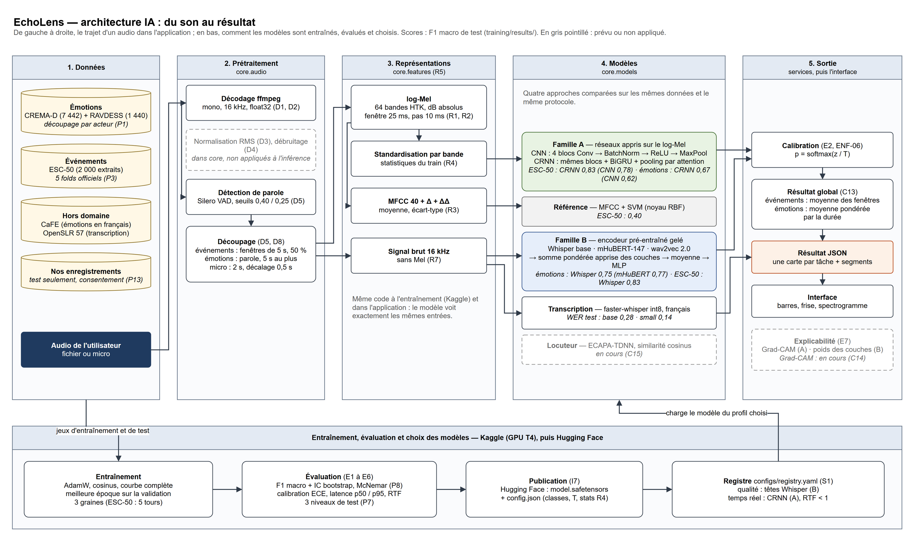

# Schéma d'architecture IA

Décisions : D1 à D8 (prétraitement), R1 à R7 (représentations), P1 à P8 (données et protocole),
familles A, B et référence (brique 4), E1 à E7 (évaluation), S1 (registre), C13 (résultats),
I7 (poids sur Hugging Face).

Sources des chiffres : `training/results/` (F1 macro de test ; ESC-50 : moyenne des 5 tours, P3 ;
émotions : moyenne des 3 graines, P1), `configs/registry.yaml`, `configs/inference.yaml`.

Source modifiable : [`architecture-ia.drawio`](architecture-ia.drawio), à ouvrir dans draw.io.
Après une modification, réexporter l'image : Fichier > Exporter en > PNG, zoom 200 %, dans
`images/architecture-ia.png`.

## Lecture, de gauche à droite

| Étape | Ce qui se passe | Pourquoi |
| --- | --- | --- |
| **1. Données** | Les jeux publics servent à entraîner et tester (bande du bas). Dans l'application, l'entrée est l'audio de l'utilisateur | Découpage par acteur pour les émotions (P1), folds officiels pour ESC-50 (P3) : on teste toujours sur des voix ou des sons jamais vus |
| **2. Prétraitement** | ffmpeg décode n'importe quel format en mono 16 kHz ; Silero VAD repère la parole ; l'audio est découpé en fenêtres | 16 kHz suffit pour la voix (Nyquist : 8 kHz). Les émotions ne sont calculées que sur la parole, les événements sur des fenêtres de 5 s, la durée des extraits d'ESC-50 |
| **3. Représentations** | Trois entrées : le log-Mel standardisé (famille A), les MFCC résumés (référence), le signal brut (famille B) | Un seul module `core.features`, le même à l'entraînement et dans l'application (R5) |
| **4. Modèles** | Famille A : CNN et CRNN appris de zéro sur le log-Mel. Famille B : un encodeur de parole pré-entraîné et gelé, dont on apprend seulement la combinaison des couches et un petit classifieur. Référence : SVM sur MFCC | Le sujet impose de comparer deux familles ; la référence classique montre ce que l'apprentissage profond apporte |
| **5. Sortie** | Les scores deviennent des probabilités calibrées, puis un résultat global par tâche, renvoyé en JSON à l'interface | Calibrer (ENF-06) : un modèle qui annonce 80 % doit avoir raison environ 8 fois sur 10 |
| **Bande du bas** | Entraînement sur Kaggle, évaluation (F1, intervalles, McNemar, calibration, latence), publication sur Hugging Face, inscription au registre | Le registre choisit le modèle de chaque profil : qualité ou temps réel |

## Les résultats qui justifient les choix

| Tâche | Référence (SVM) | Famille A | Famille B | Retenu |
| --- | --- | --- | --- | --- |
| Événements (ESC-50, F1 macro) | 0,40 | CNN 0,78 · **CRNN 0,83** | wav2vec 2.0 0,68 · mHuBERT 0,79 · **Whisper 0,83** | Qualité : Whisper (B) ; temps réel : CRNN (A) |
| Émotions (CREMA-D + RAVDESS, F1 macro) | — | CNN 0,62 · **CRNN 0,67** | wav2vec 2.0 0,75 · **mHuBERT 0,77** · Whisper 0,75 | Qualité : Whisper (B) ; temps réel : CRNN (A) |
| Transcription (OpenSLR 57, WER test) | — | — | Whisper base 0,28 · small 0,14 | faster-whisper int8 |

À savoir dire :
- **Événements** : le CRNN (0,83) et Whisper (0,83) ne sont pas significativement différents
  (McNemar, p = 0,33). On garde le CRNN pour le temps réel, parce qu'il est léger (0,7 M de
  paramètres, contre 20,7 M pour Whisper avec son encodeur).
- **Émotions** : Whisper (0,75) dépasse nettement le CRNN (0,68 sur le même test), et l'écart est
  significatif (McNemar, p < 0,001, corrigé de Holm) : c'est l'hypothèse H1, confirmée.
- **mHuBERT** est le meilleur sur les émotions (0,77), mais le modèle de production reste Whisper,
  le même encodeur que pour les événements.

## Ce qui est en gris

- **Normalisation RMS et débruitage** (D3, D4) : codés dans `core.audio`, mais pas appelés pendant
  l'analyse.
- **Locuteur** (C15) et **Grad-CAM** (C14) : en cours.
