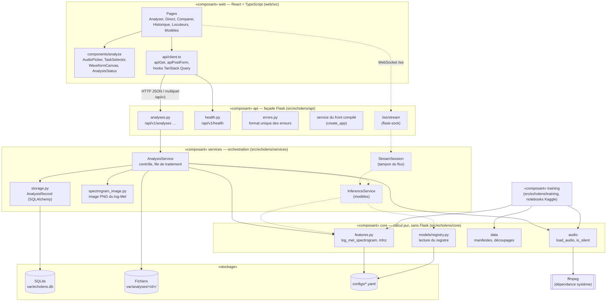

# Diagramme de composants

Décisions : architecture en quatre couches (`docs/adr/0001-architecture-en-couches.md`), U1 à
U4 (front), S1 à S4 (service et API), R5 (features), règles d'architecture de `CLAUDE.md`.

Mermaid n'a pas de notation UML de composants : le diagramme utilise des groupes (un par couche)
et des flèches de dépendance. Les éléments en **pointillés** n'existent pas encore.

## Diagramme

## Rôle de chaque composant

| Composant | Rôle | Ce qu'il a le droit d'appeler |
| --- | --- | --- |
| **web** | Interface en français, compilée dans `web/dist` | **Seulement l'API** (règle 7 de `CLAUDE.md`) ; aucun calcul de features (R5) |
| **api** | Traduit HTTP ↔ service ; documente l'API (`/docs`) ; sert le front compilé | `services` ; aucune logique métier (règle 4) |
| **services** | Contrôle des fichiers, traitement en arrière-plan (pool de threads, S2), base de données (S3), images | `core`, le stockage |
| **core** | Calcul pur : décodage, features, données, registre | Rien de Flask, ni `api` ni `services` (règle 1) ; installé tel quel sur Kaggle |
| **training** | Entraînement et évaluation (SVM sur ESC-50, évaluation) | `core`, pour utiliser **le même code de features** qu'en production (R5, ENF-07) |
| **stockage** | Base SQLite pour l'historique ; audios et images sur disque ; paramètres en YAML | — |

## Règle à savoir expliquer : les dépendances ne remontent jamais

Les flèches vont toujours vers le bas : web → api → services → core. `core` ne connaît ni Flask
ni la base de données. C'est ce qui permet d'installer `core` seul dans un notebook Kaggle, et
d'être sûr que **le spectrogramme de l'entraînement est calculé par le même code** que celui de
l'application.

## Interfaces existantes entre api et services

`AnalysisService` (`src/echolens/services/analysis_service.py`) : `create_analysis`,
`get_analysis`, `list_analyses`, `delete_analysis`, `converted_audio_path`, `spectrogram_path`.
