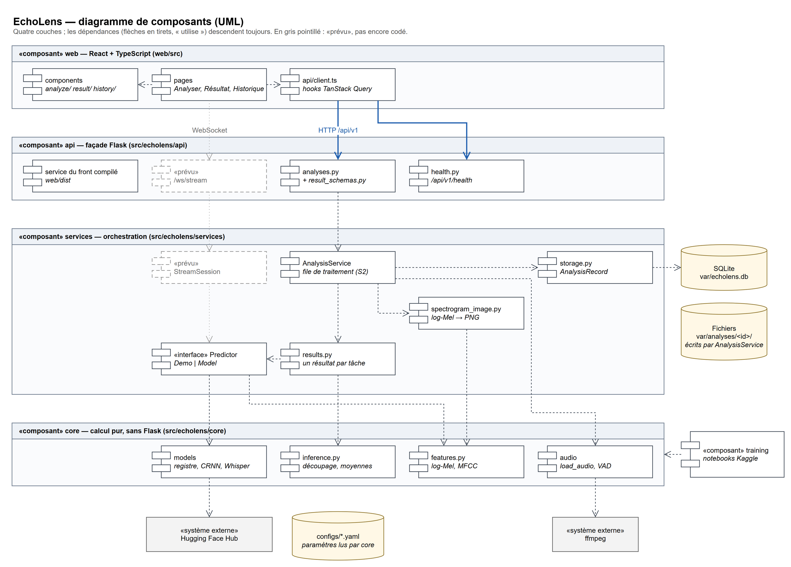

# Diagramme de composants

Décisions : architecture en quatre couches (`docs/adr/0001-architecture-en-couches.md`), U1 à
U7 (front), S1 à S4 (service et API), R5 (features), C13 (résultats et modèles), règles
d'architecture de `CLAUDE.md`.

Notation UML : chaque couche est un groupe, chaque module un composant (rectangle à deux
onglets) ; une flèche en tirets est une dépendance (« utilise »). Les éléments en **pointillés** n'existent pas encore.

## Diagramme

Source modifiable : [`composants.drawio`](composants.drawio), à ouvrir dans draw.io (application ou app.diagrams.net). Après une modification, réexporter l'image : Fichier > Exporter en > PNG, zoom 200 %, dans `images/composants.png`.

## Rôle de chaque composant

| Composant | Rôle | Ce qu'il a le droit d'appeler |
| --- | --- | --- |
| **web** | Interface en français, compilée dans `web/dist` | **Seulement l'API** (règle 7) ; aucun calcul sur le signal (R5) |
| **api** | Traduit HTTP ↔ service ; décrit le contrat (schémas marshmallow) et le documente (`/docs`) ; sert le front compilé | `services` ; aucune logique métier (règle 4) |
| **services** | Contrôle des fichiers, traitement en arrière-plan (S2), base (S3), image du spectrogramme, calcul des résultats avec un prédicteur | `core`, le stockage |
| **core** | Calcul pur : décodage, détection de parole, features, découpage pour l'inférence, réseaux | Rien de Flask, ni `api` ni `services` (règle 1) ; installé tel quel sur Kaggle |
| **training** | Entraînement et évaluation (Kaggle) | `core`, pour utiliser **le même code** qu'en production (R5, ENF-07) |
| **stockage** | Base SQLite (historique et résultats) ; audios et images sur disque ; paramètres en YAML | — |

## L'interface Predictor : deux prédicteurs interchangeables

`results.py` ne connaît que l'interface `Predictor` (`supports`, `model_info`, `predict`). Deux
classes la respectent :

- **`DemoPredictor`** : de fausses probabilités, toujours les mêmes, sans torch. Il sert à la CI et
  au développement du front ; ses résultats portent `model_id = "demo"`, et l'interface affiche un
  bandeau qui le dit.
- **`ModelPredictor`** : les vrais modèles du registre, téléchargés depuis Hugging Face, calibrés.
  Seul module des services qui importe torch.

On choisit l'un ou l'autre avec `inference_backend` (`configs/app.yaml`, ou la variable
`ECHOLENS_INFERENCE_BACKEND`), sans toucher au reste du code.

## Règle à savoir expliquer : les dépendances ne remontent jamais

Les flèches vont toujours vers le bas : web → api → services → core. `core` ne connaît ni Flask
ni la base de données. C'est ce qui permet d'installer `core` seul dans un notebook Kaggle, et
d'être sûr que **le spectrogramme de l'entraînement est calculé par le même code** que celui de
l'application.

## Interfaces entre api et services

`AnalysisService` (`src/echolens/services/analysis_service.py`) : `create_analysis`,
`get_analysis`, `list_analyses`, `delete_analysis`, `converted_audio_path`, `spectrogram_path`.
