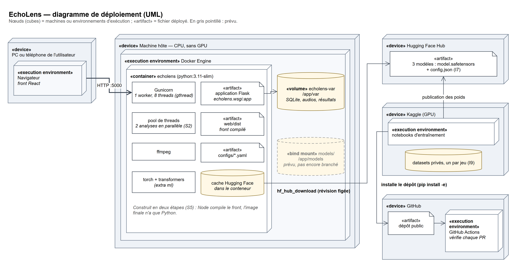

# Diagramme de déploiement

Décisions : S5 (Docker multi-étapes, Gunicorn en mode threads), ENF-08 (lancement en une
commande via Docker, sans GPU ni Node), I4 (CI GitHub Actions), I7 (poids sur le Hugging Face
Hub), I9 (Kaggle), S2 (traitements en arrière-plan).

Sources : `docker/Dockerfile`, `docker/docker-compose.yml`, `.github/workflows/ci.yml`.
Notation UML : les nœuds sont des cubes (`«device»`, `«execution environment»`), les
artefacts des feuilles à coin plié, les stockages des cylindres. Les éléments en **pointillés** n'existent pas encore.

## Diagramme

Source modifiable : [`deploiement.drawio`](deploiement.drawio), à ouvrir dans draw.io (application ou app.diagrams.net). Après une modification, réexporter l'image : Fichier > Exporter en > PNG, zoom 200 %, dans `images/deploiement.png`.

## Lecture du diagramme

| Nœud | Ce qui s'y exécute | Justification |
| --- | --- | --- |
| Navigateur | Le front React compilé, servi par Flask | Aucun Node chez l'utilisateur (ENF-08) |
| Conteneur `echolens` | Gunicorn → Flask, plus le pool de threads des analyses, plus ffmpeg | Une seule commande : `make docker` (ENF-08) |
| Gunicorn `gthread`, 1 worker, 8 threads | Les requêtes HTTP et, plus tard, les WebSockets | Un WebSocket occupe un thread tant qu'il est ouvert : il faut des threads, pas un worker par requête (commentaire du `Dockerfile`). **Un seul** worker, car le pool d'analyses et la mémoire des modèles vivent dans ce processus |
| Volume `echolens-var` | Base SQLite (historique et résultats), audios importés, spectrogrammes | L'historique survit à un redémarrage du conteneur |
| torch et transformers | Les vrais modèles (`ModelPredictor`), sur CPU | Installés dans l'image (`uv sync --extra ml`) ; utilisés seulement avec `ECHOLENS_INFERENCE_BACKEND=models`, sinon c'est le faux prédicteur `demo` |
| Cache Hugging Face | Les poids téléchargés à la première utilisation (`hf_hub_download`) | Toujours la **révision figée** dans `configs/registry.yaml` : le modèle ne change pas sans qu'on le décide |
| Montage `models/` en lecture seule | Prévu pour des poids déjà téléchargés | Les poids ne sont jamais dans l'image ni dans le dépôt (I7) |
| Kaggle | Entraînement sur GPU, avec les datasets privés | Pas de GPU sur la machine hôte ; données jamais dans le dépôt (I8, I9) |
| Hugging Face Hub | Les trois modèles publiés (`model.safetensors` + `config.json`) | Lien entre l'entraînement (Kaggle) et l'application (I7) ; safetensors ne peut pas exécuter de code caché, contrairement à pickle |
| GitHub Actions | Lint, typage, tests, build du front | `main` protégée : CI verte avant fusion (I4, I5) |

**Construction de l'image en deux étapes (S5) :** une étape Node compile le front (`npm run build`),
puis une image Python légère ne récupère que `web/dist`. L'image finale ne contient donc pas Node.

## Écarts avec le code actuel

1. **Risque pour la démo : le cache Hugging Face n'est pas dans un volume.** Les poids sont
   téléchargés dans le conteneur. S'il est recréé, ils sont téléchargés de nouveau, ce qui
   demande internet, alors que le plan de la démo prévoit de s'en passer. Deux corrections
   possibles :
   - monter un volume sur le cache Hugging Face ;
   - ou écrire la cible `make models` et régler `ECHOLENS_MODELS_DIR=/app/models`.
2. `docker-compose.yml` monte `../models` et son commentaire cite `make models`, mais **cette
   cible n'existe pas encore** dans le `Makefile`, et `models_dir` n'est pas réglé : ce montage
   ne sert à rien pour l'instant.
3. Par défaut, `inference_backend` vaut `demo`. Pour les vrais modèles, il faut
   `ECHOLENS_INFERENCE_BACKEND=models` (et `ECHOLENS_PRELOAD_MODELS=true` pour la démo), par
   exemple dans `.env`.
4. La route WebSocket n'existe pas encore (voir `sequence-flux-micro.md`).
