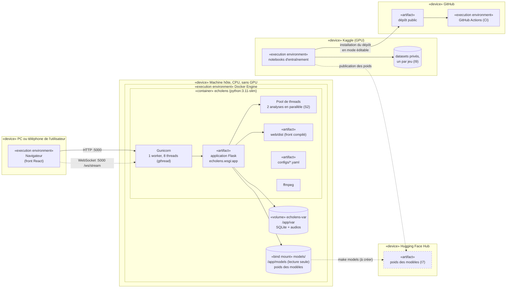

# Diagramme de déploiement

Décisions : S5 (Docker multi-étapes, Gunicorn en mode threads), ENF-08 (lancement en une
commande via Docker, sans GPU ni Node), I4 (CI GitHub Actions), I7 (poids sur le Hugging Face
Hub), I9 (Kaggle), S2 (traitements en arrière-plan).

Sources : `docker/Dockerfile`, `docker/docker-compose.yml`, `.github/workflows/ci.yml`.
Mermaid n'a pas de notation UML de déploiement : les nœuds sont des groupes, les artefacts des
rectangles. Les éléments en **pointillés** n'existent pas encore.

## Diagramme

## Lecture du diagramme

| Nœud | Ce qui s'y exécute | Justification |
| --- | --- | --- |
| Navigateur | Le front React compilé, servi par Flask | Aucun Node chez l'utilisateur (ENF-08) |
| Conteneur `echolens` | Gunicorn → Flask, plus le pool de threads des analyses, plus ffmpeg | Une seule commande : `make docker` (ENF-08) |
| Gunicorn `gthread`, 1 worker, 8 threads | Les requêtes HTTP et, plus tard, les WebSockets | Un WebSocket occupe un thread tant qu'il est ouvert : il faut des threads, pas un worker par requête (commentaire du `Dockerfile`). **Un seul** worker, car le pool d'analyses et la mémoire des modèles vivent dans ce processus |
| Volume `echolens-var` | Base SQLite, audios importés, spectrogrammes | L'historique survit à un redémarrage du conteneur |
| Montage `models/` en lecture seule | Les poids téléchargés | Les poids ne sont jamais dans l'image ni dans le dépôt (I7) |
| Kaggle | Entraînement sur GPU, avec les datasets privés | Pas de GPU sur la machine hôte ; données jamais dans le dépôt (I8, I9) |
| Hugging Face Hub | Stockage des poids entraînés | Lien entre l'entraînement (Kaggle) et l'application (I7) |
| GitHub Actions | Lint, typage, tests, build du front | `main` protégée : CI verte avant fusion (I4, I5) |

**Construction de l'image en deux étapes (S5) :** une étape Node compile le front (`npm run build`),
puis une image Python légère ne récupère que `web/dist`. L'image finale ne contient donc pas Node.

## Écarts avec le code actuel

1. `docker-compose.yml` monte `../models` et son commentaire cite `make models`, mais **cette
   cible n'existe pas encore** dans le `Makefile`. Le téléchargement des poids depuis le Hugging
   Face Hub est donc à écrire.
2. Aucun modèle n'est publié sur le Hub (`configs/registry.yaml` est vide).
3. La route WebSocket n'existe pas encore (voir `sequence-flux-micro.md`).
