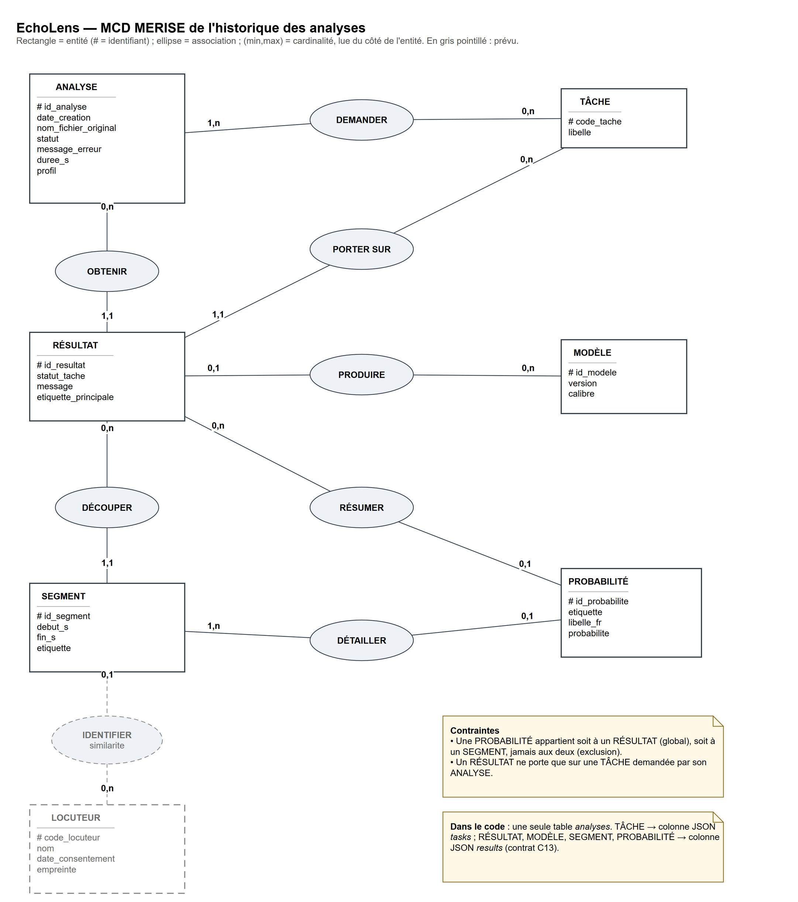

# MCD MERISE — historique des analyses

Décisions : S3 (SQLite via SQLAlchemy, fichiers sur disque), EF-08 (historique), EF-05, EF-06,
EF-10, EF-11, EF-12 (résultats par segment), C13 (contrat des résultats), S1 (registre des
modèles).

Sources : la table `analyses` de `src/echolens/services/storage.py` (classe `AnalysisRecord`), le
contrat des résultats de `src/echolens/api/result_schemas.py`, `configs/labels.yaml` (classes) et
`configs/registry.yaml` (modèles). Seul le LOCUTEUR est encore une proposition.

## Diagramme

Légende :
- rectangle = entité, son identifiant précédé de `#` ;
- ellipse = association, ses attributs écrits sous son nom ;
- `1,n` = cardinalité, lue du côté de l'entité ;
- `(1,1)` **entre parenthèses** = identification relative : l'entité est identifiée par l'entité
  à laquelle elle se rattache ;
- en gris pointillé : ce qui n'existe pas encore.

Source modifiable : [`mcd-historique.drawio`](mcd-historique.drawio), à ouvrir dans draw.io
(application ou app.diagrams.net). Après une modification, réexporter l'image : Fichier > Exporter
en > PNG, zoom 200 %, dans `images/mcd-historique.png`.

## Les entités

| Entité | Identifiant | Ce qu'elle représente | Exemple |
| --- | --- | --- | --- |
| ANALYSE | `id_analyse` | Un audio importé et son traitement | `entretien.wav`, terminée, 41,2 s, profil Qualité |
| TÂCHE | `code_tache` | Ce qu'on peut demander | `emotion` / « Émotion » |
| RÉSULTAT | **relatif** : ANALYSE + TÂCHE | La réponse à **une** tâche demandée par **une** analyse | (analyse 12, `emotion`) : `done` |
| CLASSE | `code_classe` | Une classe que peut prédire une tâche | `angry` / « Colère » |
| SEGMENT | `id_segment` | Un morceau de l'audio, pour la frise (EF-12) | de 5,0 à 10,0 s |
| MODÈLE | `id_modele` | Un modèle du registre | `echolens-sound-event-crnn`, famille A |
| VERSION | **relatif** : MODÈLE + `numero_version` | Une version publiée de ce modèle | 1.0.0, révision Hugging Face, calibrée, T = 1,4 |
| LOCUTEUR *(proposé)* | `code_locuteur` | Une personne enregistrée avec son consentement (EF-11, ENF-10) | p04 |

## Les associations et leurs cardinalités

| Association | Côté gauche | Côté droit | Attribut | Ce que ça dit |
| --- | --- | --- | --- | --- |
| OBTENIR | ANALYSE `1,n` | RÉSULTAT `(1,1)` | | Une analyse a au moins un résultat, un par tâche demandée ; un résultat appartient à une seule analyse, qui fait partie de son identifiant |
| PORTER SUR | TÂCHE `0,n` | RÉSULTAT `(1,1)` | | Un résultat porte sur une seule tâche, qui fait partie de son identifiant |
| APPARTENIR | TÂCHE `0,n` | CLASSE `1,1` | | Une classe appartient à une tâche (6 émotions, 50 événements ; aucune pour la transcription) |
| ESTIMER | RÉSULTAT `0,n` | CLASSE `0,n` | `probabilite` | Le résultat global : une probabilité par classe ; aucune si `no_speech` ou `unavailable` |
| DÉCOUPER | RÉSULTAT `0,n` | SEGMENT `1,1` | | Aucun segment si `no_speech` ou `unavailable` ; sinon les fenêtres de 5 s ou les morceaux de parole |
| DÉTAILLER | SEGMENT `1,n` | CLASSE `0,n` | `probabilite` | Les probabilités de chaque segment |
| AVOIR | MODÈLE `1,n` | VERSION `(1,1)` | | Un modèle a une ou plusieurs versions ; une version n'existe que par son modèle |
| PRODUIRE | VERSION `0,n` | RÉSULTAT `0,1` | | Un résultat vient d'au plus une version précise ; aucune si la tâche n'est pas branchée |
| IDENTIFIER *(proposée)* | SEGMENT `0,1` | LOCUTEUR `0,n` | `similarite` | Un segment est attribué à au plus un locuteur ; aucun sous le seuil (« inconnu ») |

## Les choix de modélisation, et pourquoi

1. **Pas d'association DEMANDER à côté de RÉSULTAT.** Un résultat, c'est la réponse à une tâche
   demandée par une analyse : c'est le même concept. Il devient une **entité identifiée
   relativement** à ANALYSE et TÂCHE, plutôt qu'une association, pour deux raisons :
   - SEGMENT, ESTIMER et PRODUIRE doivent s'y rattacher, et en MERISE une association ne peut pas
     être reliée à une autre association ;
   - son identifiant (analyse, tâche) garantit à lui seul qu'il n'y a **pas deux résultats pour la
     même analyse et la même tâche**. Il garantit aussi qu'un résultat porte forcément sur une
     tâche de son analyse, sans note à ajouter.

   Le résultat existe dès la demande (`statut_resultat` « en attente »), puis prend `done`,
   `no_speech` ou `unavailable` à la fin du traitement.
2. **CLASSE est une entité (3e forme normale).** Le libellé « Colère » dépend de la classe
   `angry`, pas de chaque probabilité. Le garder dans la probabilité créerait une dépendance
   transitive (identifiant → classe → libellé), interdite en 3FN, et répéterait « Colère » à
   chaque probabilité. La probabilité devient l'attribut des associations ESTIMER et DÉTAILLER,
   qui relient un résultat (ou un segment) à une classe.
3. **Pas de donnée calculable.** La classe la plus probable d'un résultat ou d'un segment se
   retrouve à partir des probabilités (la plus forte) : elle n'apparaît pas dans le MCD.
4. **VERSION est une entité.** Si la version était un simple attribut de MODÈLE, publier une v2
   écraserait la v1, et on ne saurait plus quelle version a produit une analyse d'hier. Ici, la
   v2 est une nouvelle VERSION du même MODÈLE, et chaque RÉSULTAT reste relié à la version exacte
   qui l'a produit, avec sa révision Hugging Face, sa calibration et sa température.

**Contrainte que les cardinalités ne peuvent pas exprimer.** Les probabilités d'un résultat
(ESTIMER) et de ses segments (DÉTAILLER) ne doivent porter que sur des classes de **sa** tâche :
pas de « Pluie » dans un résultat d'émotion. Cette condition relie deux chemins du modèle
(RÉSULTAT → TÂCHE et RÉSULTAT → CLASSE → TÂCHE). C'est une contrainte d'intégrité à vérifier
dans le code : au chargement, chaque modèle est comparé aux classes de `configs/labels.yaml` de
sa tâche (`ModelPredictor._check_config`).

## Du MCD au code : une seule table

Le MCD décrit les **informations** ; le code choisit comment les **ranger**.

| Partie du MCD | Rangement dans le code |
| --- | --- |
| ANALYSE | Une ligne de la table `analyses` |
| Les tâches demandées (côté TÂCHE de RÉSULTAT) | Colonne JSON `tasks`, par exemple `["emotion", "sound_event"]` |
| RÉSULTAT, SEGMENT, ESTIMER, DÉTAILLER, PRODUIRE | Colonne JSON `results` : un objet par tâche demandée (contrat de `result_schemas.py`), écrit à la fin du traitement |
| TÂCHE, CLASSE | Pas de table : les 4 tâches sont fixes dans le code (`Task`), les classes et leurs libellés dans `configs/labels.yaml` |
| MODÈLE, VERSION | Pas de table : `configs/registry.yaml` (identifiant, version, révision Hugging Face figée) et le `config.json` publié avec chaque modèle (calibration) |
| Fichiers audio et image | Sur disque, dans `var/analyses/<id_analyse>/` : la base ne garde que l'identifiant (S3) |

**Écarts volontaires au niveau physique.** Le JSON `results` recopie le libellé français de
chaque classe et la classe la plus probable (`label`, `label_fr`), ainsi que l'identifiant et la
version du modèle. C'est de la **dénormalisation**, faite exprès :
- le document est écrit en une fois et relu en une fois par la page Résultat, qui l'affiche tel
  quel, sans jointure ni recalcul ;
- recopier la version au moment de l'analyse fige l'information : une analyse d'hier garde
  `1.0.0`, même après la publication d'une v2.

Le MCD, lui, reste normalisé. Si un jour il faut chercher dans les résultats (« tous les segments
où la colère dépasse 50 % »), il dit déjà quelles tables créer.

| Attribut du MCD | Colonne de `analyses` | Type | Remarque |
| --- | --- | --- | --- |
| `# id_analyse` | `id` | `String(36)`, clé primaire | UUID généré par le service |
| `date_creation` | `created_at` | `DateTime(timezone=True)` | En UTC |
| `nom_fichier_original` | `original_filename` | `String(255)` | Nom nettoyé |
| `statut` | `status` | `String(16)` | `pending` → `processing` → `done` ou `failed` |
| `message_erreur` | `error_message` | `String`, peut être vide | Rempli seulement si `failed` |
| `duree_s` | `duration_s` | `float`, peut être vide | Connue à la fin |
| `profil` | `profile` | `String(16)` | `quality` ou `realtime` |
| *(tâches demandées)* | `tasks` | `JSON` | Liste des tâches |
| *(RÉSULTAT et ce qui en dépend)* | `results` | `JSON`, vide tant que `status ≠ done` | Contrat C13 |

## Points encore ouverts

1. **LOCUTEUR** (EF-11) : l'empreinte vocale dans la base ou sur disque ? Le retrait du
   consentement doit effacer la personne et toutes ses identifications.
2. Supprimer une analyse supprime déjà ses résultats (même ligne) et son dossier de fichiers
   (`delete_analysis`).
