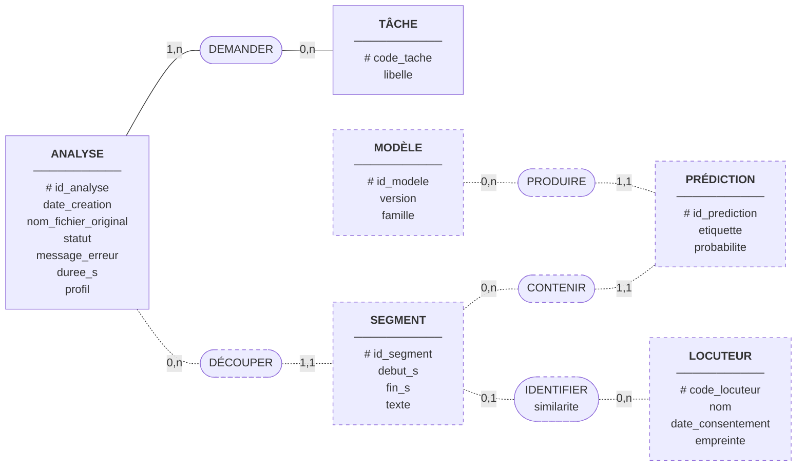

# MCD MERISE — historique des analyses

Décisions : S3 (SQLite via SQLAlchemy, fichiers sur disque), EF-08 (historique), EF-05, EF-06,
EF-10, EF-11, EF-12 (résultats par segment).

Point de départ : la table `analyses` de `src/echolens/services/storage.py`, **seule table qui
existe aujourd'hui**. Les autres entités sont des **propositions**, à valider en équipe avant de
créer les tables.

## Diagramme

Légende : rectangle = entité (identifiant souligné par `#`), forme arrondie = association,
`(min,max)` = cardinalité. Les éléments en **pointillés** n'existent pas encore dans le code.

## Ce qui existe : l'entité ANALYSE

Correspondance exacte avec la classe `AnalysisRecord` (table `analyses`) :

| Attribut du MCD | Colonne | Type SQLAlchemy | Remarque |
| --- | --- | --- | --- |
| `# id_analyse` | `id` | `String(36)`, clé primaire | UUID généré par le service |
| `date_creation` | `created_at` | `DateTime(timezone=True)` | En UTC, remplie automatiquement |
| `nom_fichier_original` | `original_filename` | `String(255)` | Nom nettoyé |
| `statut` | `status` | `String(16)` | `pending` → `processing` → `done` ou `failed` |
| `message_erreur` | `error_message` | `String`, peut être vide | Rempli seulement si `failed` |
| `duree_s` | `duration_s` | `float`, peut être vide | Connue quand le statut vaut `done` |
| `profil` | `profile` | `String(16)` | `quality` ou `realtime` |
| *(association DEMANDER)* | `tasks` | `JSON` | Voir ci-dessous |

**Écart volontaire entre le MCD et le code : les tâches.** Une analyse demande une ou plusieurs
tâches. En MERISE, un attribut ne peut pas contenir une liste (première forme normale) : on crée
donc l'entité **TÂCHE** et l'association **DEMANDER**, dont les cardinalités se lisent ainsi :

- côté ANALYSE `(1,n)` : une analyse demande au moins une tâche (l'API refuse une liste vide) ;
- côté TÂCHE `(0,n)` : une tâche peut n'avoir été demandée par aucune analyse, ou par plusieurs.

Le code, lui, range la liste dans une seule colonne JSON (`["emotion", "speaker"]`). C'est un
choix de simplicité : il n'y a que 4 tâches fixes, et on ne fait jamais de recherche « toutes les
analyses qui ont demandé l'émotion ». Si le filtrage de l'Historique (EF-08) en a besoin, le MLD
fera apparaître une table de liaison `analysis_tasks`.

**Les fichiers ne sont pas dans la base (S3).** L'audio d'origine, l'audio converti et l'image du
spectrogramme sont rangés sur disque, dans `var/analyses/<id_analyse>/` (`original.<ext>`,
`audio.wav`, `spectrogram.png`). La base ne garde que l'identifiant, qui donne le dossier.

## Ce qui est proposé : résultats par segment

| Élément | Rôle | Exigence |
| --- | --- | --- |
| SEGMENT | Une portion de l'audio (début, fin), issue du découpage (D5) ; `texte` = transcription du segment, vide si aucune | EF-10, EF-12 |
| DÉCOUPER `(0,n)` / `(1,1)` | Une analyse a zéro segment (en cours, échec) ou plusieurs ; un segment appartient à une seule analyse | EF-12 |
| PRÉDICTION | Une étiquette et sa probabilité (ex. `angry`, 0,58) | EF-05, EF-06 |
| CONTENIR `(0,n)` / `(1,1)` | Un segment porte toutes les probabilités de chaque tâche demandée | EF-05, EF-06 |
| MODÈLE | Le modèle qui a produit la prédiction (identifiant et version du registre) | S1, EF-15 |
| PRODUIRE `(0,n)` / `(1,1)` | Chaque prédiction est traçable jusqu'au modèle et à sa version | EF-15, EF-16 |
| LOCUTEUR | Une personne enregistrée **avec son consentement**, avec son empreinte vocale | EF-11, ENF-10 |
| IDENTIFIER `(0,1)` / `(0,n)`, attribut `similarite` | Un segment est attribué à au plus un locuteur ; aucun si la similarité est sous le seuil (« inconnu ») | EF-11 |

## Points à trancher en équipe

1. Le **MODÈLE** est déjà décrit dans `configs/registry.yaml`. Faut-il le recopier en table, ou ne
   garder que `id_modele` et `version` dans la PRÉDICTION ? (Proposition : ne pas créer de table,
   le registre reste la source unique, S1.)
2. Le **résultat global** de l'analyse (une émotion pour tout le fichier) : le calculer à partir
   des segments, ou le stocker ?
3. L'**empreinte** du locuteur : dans la base, ou sur disque comme les audios ?
4. Supprimer une analyse supprime ses segments et ses prédictions (suppression en cascade) ;
   supprimer un locuteur (retrait du consentement) doit aussi effacer ses identifications.
