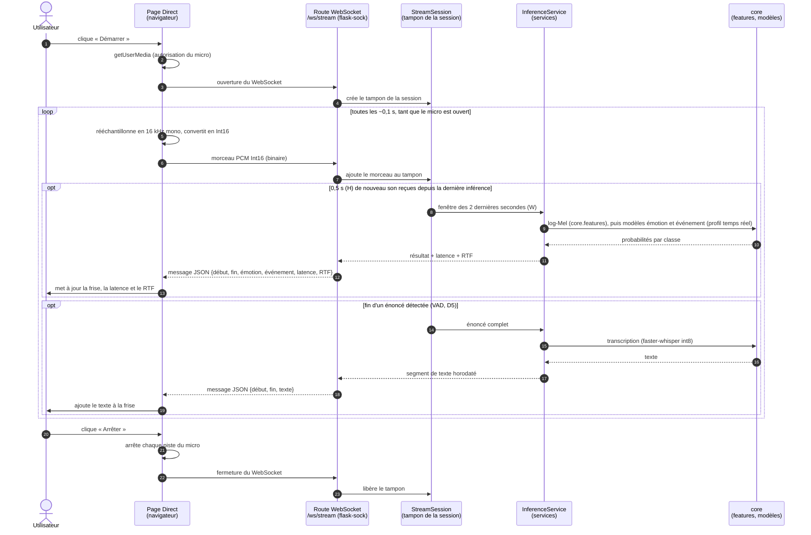

# Diagramme de séquence — flux micro en direct

Exigences et décisions : EF-14 (analyse du flux micro en direct, latence et RTF affichés),
D8 (flux PCM 16 kHz Int16 par WebSocket, fenêtre W = 2 s, décalage H = 0,5 s), D5 (détection
d'activité vocale sans torch), ENF-01 (RTF < 1), ENF-02 (latence ≈ H + temps d'inférence),
R5 (features par `core.features`), S1 (modèles du registre).

> **Rien de ce diagramme n'est encore codé.** Il n'y a ni route `/ws/stream` dans
> `src/echolens/api/`, ni service de flux, et la page Direct (`web/src/pages/LivePage.tsx`) est
> une page provisoire. Seuls existent : la dépendance `flask-sock` (`pyproject.toml`), Gunicorn en
> mode threads pour le WebSocket (`docker/Dockerfile`), le relais `/ws` de Vite
> (`web/vite.config.ts`) et `core.features.log_mel_spectrogram`.
> Les noms `StreamSession` et `InferenceService` sont des **propositions**.

## Diagramme

## Lecture du diagramme

| Étape | Ce qui se passe | Pourquoi |
| --- | --- | --- |
| 2 | Le navigateur demande l'autorisation du micro | Rien n'est enregistré sans l'accord de l'utilisateur |
| 3–4 | Un WebSocket est ouvert, avec un tampon propre à cette session | Le WebSocket garde la connexion ouverte : le son part en continu, sans une requête HTTP par morceau |
| 5–7 | Le navigateur envoie le son en PCM Int16 à 16 kHz | Format de D8 : 16 kHz est le format d'entrée des modèles (D2), et l'Int16 divise par deux le volume par rapport au float32 |
| Bloc « 0,5 s » | Toutes les 0,5 s (H), on analyse les 2 dernières secondes (W) | Les fenêtres se recouvrent de 1,5 s : on a un résultat toutes les 0,5 s, calculé sur assez de son pour reconnaître une émotion |
| 9 | Le log-Mel passe par `core.features` | R5 : même code de features qu'à l'entraînement |
| 11 | Le serveur renvoie aussi la latence et le RTF | EF-14 : ils sont affichés à l'utilisateur |
| Bloc « fin d'énoncé » | La transcription n'est lancée qu'à la fin d'une phrase | D8 : Whisper a besoin de la phrase entière, et serait trop lent toutes les 0,5 s |
| Dernières étapes | À l'arrêt, le micro est coupé et le tampon libéré | Vie privée, et mémoire du serveur |

## Contrainte de temps réel (ENF-01, ENF-02)

- **RTF** (*real-time factor*) = temps de calcul ÷ durée du son analysé. Ici, il faut que
  l'inférence d'une fenêtre prenne **moins de H = 0,5 s**, sinon les fenêtres s'accumulent et le
  retard grandit sans fin.
- **Latence perçue** ≈ H + temps d'inférence : au pire, un son prononcé juste après une
  inférence attend 0,5 s la suivante, plus le temps de calcul.

## Points à trancher

1. Où se fait le rééchantillonnage à 16 kHz : dans le navigateur (AudioWorklet), comme le
   suppose ce diagramme, ou sur le serveur ?
2. Que faire si une inférence dure plus de H : sauter des fenêtres, ou les mettre en file ?
3. Les résultats du direct sont-ils enregistrés dans l'Historique ?
